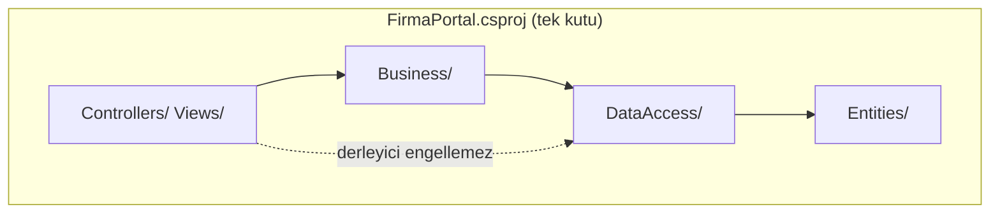

# FirmaPortal — tek modül versiyonu

[[01_Projects/dotnet-MVC/README|dotnet-MVC]] projesinin **birebir aynı kodu**, tek `.csproj` içinde. Katmanlar proje yerine klasör olarak duruyor. Önce bunu oku, sonra multi-module versiyona geç: kod aynı, sadece dosyaların "kutusu" farklı.

Onay akışı, Spring ↔ .NET kopya kağıdı ve şemalar dotnet-MVC README'sinde. Burada sadece iki versiyonun farkı anlatılıyor.

## Çalıştırma

```bash
cd "/Users/beraterkul/Documents/Obsidian/Obsidian-Vault/01_Projects/single-module-dotnet-MVC"
docker compose up -d          # dotnet-MVC ile AYNI SQL Server container'ı; o zaten açıksa bu adımı atla
dotnet run                    # http://localhost:5081 (dotnet-MVC 5080'de, ikisi aynı anda çalışabilir)
```

Veritabanı ayrı: bu versiyon `FirmaPortalSingle` veritabanını kullanıyor, dotnet-MVC ise `FirmaPortal`'ı. Kullanıcılar aynı: `calisan@` / `mudur@` / `patron@firma.com`, şifre `1234`.

## Tek modül ↔ multi-module eşleşmesi

| Burada (klasör) | dotnet-MVC'de (proje) | Spring (tek modül) |
|---|---|---|
| `FirmaPortal.csproj` | 4 ayrı `.csproj` + `FirmaPortal.sln` | tek `pom.xml` |
| `Entities/` | `FirmaPortal.Entities` | `domain/` paketi |
| `DataAccess/` | `FirmaPortal.DataAccess` | `repository/` paketi |
| `Business/` | `FirmaPortal.Business` | `service/` paketi |
| kökteki `Controllers/`, `Views/`, `ViewModels/`, `Program.cs` | `FirmaPortal.Web` | `controller/` + `templates/` + `Application.java` |
| yok | `tests/FirmaPortal.Tests` | `src/test/java` |

Namespace'ler klasörleri izliyor (`FirmaPortal.Business.Services`, `FirmaPortal.Controllers` …). Java'daki package = klasör kuralının .NET'teki konvansiyonu; ama .NET bunu **zorunlu tutmaz**, sadece alışkanlıktır.



## Ne kaybettik? (asıl ders bu)

Multi-module'de oklar **derleyici kuralı**: `Entities` projesinin EF Core referansı yok, yani bir entity'ye `using Microsoft.EntityFrameworkCore;` yazarsan kod derlenmez. `Web` projesi `DataAccess`'i doğrudan referans etmiyor; controller'dan `AppDbContext` kullanmak da zorlaşıyor.

Tek modülde bu oklar sadece **anlaşma**. Controller'a `AppDbContext` enjekte edip doğrudan sorgu yazsan da derlenir; katmanı korumak code review'a kalır. Kesikli ok bunu gösteriyor.

Bu yüzden:
- Küçük/orta projede tek modül gayet normal (`dotnet new mvc` şablonu da tek proje).
- Ekip büyüyünce ya da katman ihlali sık olunca proje proje ayırırlar, böylece kuralı derleyici korur.

## Neler aynı kaldı
- Tüm `.cs` ve `.cshtml` dosyalarının içeriği. Fark sadece `FirmaPortal.Web.X` namespace'lerinin `FirmaPortal.X` olması ve iki yorum satırı.
- Migration dosyaları (`DataAccess/Migrations/`). DbContext artık web uygulamasıyla aynı assembly'de olduğu için `dotnet ef` komutu kısaldı:
  `dotnet ef migrations add <Ad>` (multi'de `--project` ve `--startup-project` vermek gerekiyordu).

## Neden test projesi yok?
.NET'te test kodu her zaman **ayrı bir projede** durur; Maven'daki gibi aynı modülün `src/test` klasörü olmaz. Tek modül dediğimiz için buraya koymadım. Testler: `dotnet-MVC/tests/FirmaPortal.Tests/DocumentTests.cs`.
